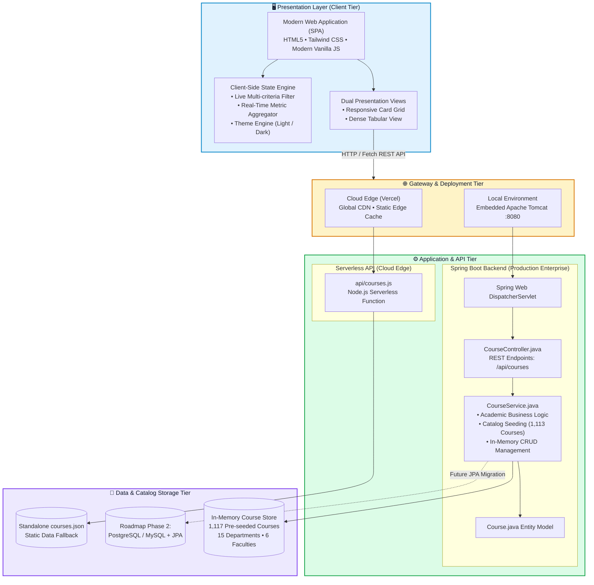
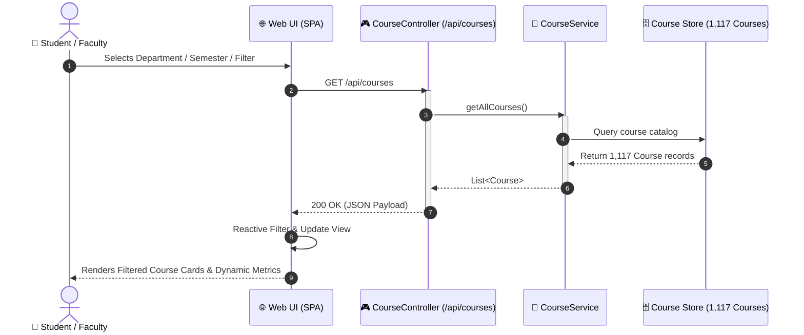

<p align="center">
  
</p>

<h1 align="center">IIUC Course Portal — Academic Management System</h1>

<p align="center">
  <b>A modern, enterprise-ready full-stack academic management platform and RESTful API for International Islamic University Chittagong (IIUC)</b>
</p>

<p align="center">
  <a href="https://spring.io/projects/spring-boot"></a>
  <a href="https://www.oracle.com/java/"></a>
  <a href="#"></a>
  <a href="https://tailwindcss.com/"></a>
  <a href="#"></a>
  <a href="LICENSE"></a>
</p>

<p align="center">
  <a href="https://iiuccourse-restapi.vercel.app/" target="_blank">
    
  </a>
  <a href="https://ridwanulkarim.github.io/iiucRESTAPI/" target="_blank">
    
  </a>
</p>

---

## 🌟 Executive Summary

The **IIUC Course Portal** is an all-inclusive academic management platform designed to streamline course discovery, curriculum tracking, and degree planning across **International Islamic University Chittagong (IIUC)**. 

Built with a high-performance **Java 21 / Spring Boot 3** backend and a reactive **HTML5 / Tailwind CSS / Vanilla JavaScript** frontend, the system encapsulates verified semester curriculums across **15 academic departments** within **6 faculties**, covering over **1,117 accredited courses** with credits, theory/lab classifications, and prerequisite tracking.

---

## 🏛️ System Architecture

The application adopts a decoupled, multi-tier client-server architecture designed for high availability, low latency, and dual deployment flexibility (Enterprise Spring Boot JVM or Edge Serverless Function).

### High-Level Multi-Tier Architecture Diagram



### Request-Response Lifecycle (Sequence Diagram)



---

## 🏛️ Academic Scope & Department Breakdown

The catalog incorporates the entire undergraduate curriculum of IIUC across **6 Faculties** and **15 Academic Departments**:

| Faculty | Department | Total Courses | Semesters |
| :--- | :--- | :---: | :---: |
| **Faculty of Science and Engineering (FSE)** | Computer Science and Engineering (CSE) | **128** | 1st – 8th + Electives |
| | Computer & Communication Engineering (CCE) | **108** | 1st – 8th + Options I & II |
| | Electrical & Electronic Engineering (EEE) | **102** | 1st – 8th + Electives |
| | Electronic & Telecommunication Engineering (ETE) | **101** | 1st – 8th + Electives |
| | Civil Engineering (CE) | **100** | 1st – 8th + Electives |
| | Pharmacy | **83** | 1st – 8th |
| **Faculty of Arts and Humanities** | English Language and Literature (ELL) | **51** | 1st – 8th |
| | Arabic Language and Literature (ALL) | **56** | 1st – 8th |
| **Faculty of Shariah and Islamic Studies** | Qur'anic Sciences and Islamic Studies (QSIS) | **51** | 0th – 8th |
| | Da'wah and Islamic Studies (DIS) | **70** | 1st – 8th |
| | Science of Hadith and Islamic Studies (SHIS) | **5** | 1st – 5th |
| **Faculty of Business Studies** | Business Administration (BBA) | **99** | 1st – 8th + Majors |
| | Finance | **59** | 1st – 8th |
| **Faculty of Social Sciences** | Economics and Banking | **54** | 1st – 8th |
| **Faculty of Law** | Law and Land Management | **50** | 1st – 8th |
| **Total Academic Scope** | **15 Departments Across 6 Faculties** | **1,117 Courses** | **0th – 8th** |

---

## ✨ Key Features

- 🔍 **Instant Live Search**: Sub-millisecond multi-attribute filtering across course codes, titles, instructors, and prerequisites.
- 🏫 **Hierarchical Academic Grouping**: Multi-tier dropdown filtering structured by official university faculties and departments.
- 🏷️ **Course Typing Badges**: Color-differentiated badges identifying **Theory** (lecture) vs **Lab** (sessional, practical, viva).
- 🎓 **Semester Range Selector**: Complete progression support from **0th / Foundation Semester** through **8th Semester**.
- 📊 **Dynamic Live Metrics**: Instant re-calculation of total courses, cumulative credit hours, and department distribution.
- 🗂️ **Dual View Presentation**:
  - **Card Grid View**: Visual cards with status indicators and quick-action modals.
  - **Table View**: Compact, sortable tabular data layout.
- 🌓 **Adaptive Theme Engine**: Built-in CSS custom property theme switcher (Dark / Light) with persistent `localStorage`.
- ⚡ **Full CRUD Capabilities**: Modal dialogs for adding new courses, updating information, and safe deletion confirmation.
- 📱 **Fully Responsive Layout**: Built with a mobile-first philosophy, adapting across smartphones, tablets, and widescreen desktop displays.

---

## 📡 RESTful API Documentation

Base URL: `http://localhost:8080/api/courses` (Local) or `https://iiuccourse-restapi.vercel.app/api/courses` (Cloud)

### Endpoints Specification

| Method | Endpoint | Description | Request Body | Status Code |
| :--- | :--- | :--- | :--- | :---: |
| **GET** | `/api/courses` | Retrieve all 1,117 academic courses | None | `200 OK` |
| **GET** | `/api/courses/{id}` | Retrieve specific course details by ID | None | `200 OK` / `404 Not Found` |
| **POST** | `/api/courses` | Create a new academic course entry | Course JSON | `201 Created` |
| **PUT** | `/api/courses/{id}` | Modify an existing course record | Course JSON | `200 OK` / `404 Not Found` |
| **DELETE** | `/api/courses/{id}` | Delete a course record by ID | None | `200 OK` / `404 Not Found` |

### Sample Course Payload

```json
{
  "courseCode": "CSE-1121",
  "courseTitle": "Computer Programming I",
  "courseCredit": 3.0,
  "courseType": "Theory",
  "semesterOffered": "1st",
  "deptName": "Computer Science and Engineering (CSE)",
  "instructor": "Faculty Member",
  "prerequisite": ""
}
```

### Example cURL Commands

```bash
# 1. Fetch all courses
curl -X GET http://localhost:8080/api/courses

# 2. Fetch specific course by ID
curl -X GET http://localhost:8080/api/courses/100

# 3. Create a new course
curl -X POST http://localhost:8080/api/courses \
  -H "Content-Type: application/json" \
  -d '{"courseCode":"CSE-4800","courseTitle":"Cloud Computing","courseCredit":3.0,"courseType":"Theory","semesterOffered":"8th","deptName":"Computer Science and Engineering (CSE)","instructor":"Faculty Member","prerequisite":"CSE-3500"}'
```

---

## 💻 Tech Stack & Tooling

| Domain | Technology / Library | Purpose |
| :--- | :--- | :--- |
| **Backend Framework** | Spring Boot 3.5.9 | High-performance enterprise RESTful web service |
| **Programming Language**| Java 21 (LTS) | Core backend programming language |
| **Build & Dependency** | Apache Maven (`mvnw`) | Build lifecycle automation and dependency management |
| **Serverless Backend** | Node.js / Vercel Serverless | Edge execution for zero-maintenance cloud hosting |
| **Frontend Styling** | Tailwind CSS (v3 CDN) | Modern utility-first responsive design system |
| **Frontend Scripting** | Vanilla JavaScript (ES6+) | Reactive state management, DOM operations, Fetch API |
| **Version Control** | Git & GitHub | Collaborative version control and deployment pipelines |

---

## 🚀 Local Quick Start Guide

### Prerequisites
- **Java JDK 21** or higher
- **Git**
- Terminal access (macOS, Linux, or Windows PowerShell)

### 1. Clone the Repository
```bash
git clone https://github.com/Ridwanulkarim/iiucRESTAPI.git
cd iiucRESTAPI
```

### 2. Run the Application
Use the included Maven wrapper (no pre-installed Maven required):
```bash
# macOS / Linux
./mvnw spring-boot:run

# Windows CMD / PowerShell
mvnw.cmd spring-boot:run
```

### 3. Access the Portal
Open your favorite web browser and navigate to:
👉 **`http://localhost:8080`**

---

## ⚡ Deployment on Vercel

The repository includes a preconfigured [`vercel.json`](./vercel.json) allowing one-click serverless deployment:

[](https://vercel.com/new/clone?repository-url=https%3A%2F%2Fgithub.com%2FRidwanulkarim%2FiiucRESTAPI)

1. Connect your GitHub repository to [Vercel](https://vercel.com).
2. Vercel automatically detects [`vercel.json`](./vercel.json), publishing the static frontend and provisioning the `/api/courses` serverless API.

---

## 📂 Project Structure

```text
iiucRESTAPI/
├── README.md                           # Comprehensive documentation & architecture
├── pom.xml                             # Maven build configuration (Java 21, Spring Boot 3)
├── mvnw / mvnw.cmd                     # Cross-platform Maven wrapper scripts
├── vercel.json                         # Vercel serverless routing configuration
├── LICENSE                             # MIT License
├── api/
│   ├── courses.js                      # Vercel serverless REST API function
│   └── _data/
│       └── courses.json                # JSON catalog backup (1,113 courses)
├── src/
│   ├── main/
│   │   ├── java/com/iiuc/iiucAPI/
│   │   │   ├── IiucApiApplication.java # Spring Boot application entry point
│   │   │   ├── controller/
│   │   │   │   └── CourseController.java # REST API controller endpoints
│   │   │   ├── model/
│   │   │   │   └── Course.java         # Course domain entity model
│   │   │   └── service/
│   │   │       └── CourseService.java  # Catalog ingestion & business logic
│   │   └── resources/
│   │       ├── application.properties  # Spring Boot configuration
│   │       └── static/                 # Production-grade web interface
│   │           ├── index.html          # Semantic HTML5 Single Page Application
│   │           ├── css/app.css         # Modern design tokens & theme variables
│   │           ├── js/app.js           # Reactive UI logic & REST client
│   │           ├── img/iiuc-logo.png   # Official university logo
│   │           └── data/courses.json   # Static fallback course catalog
│   └── test/
│       └── java/com/iiuc/iiucAPI/
│           └── IiucApiApplicationTests.java # Context loading tests
```

---

## 🔮 Future Scope & Roadmap

- [ ] **Phase 1: Persistent Database Integration** — Connect PostgreSQL / MySQL with Spring Data JPA.
- [ ] **Phase 2: Security & Identity Management** — Introduce Spring Security 6 with JWT for role-based student/faculty logins.
- [ ] **Phase 3: Interactive Swagger Documentation** — Integrate `springdoc-openapi` for browser-based API testing at `/swagger-ui.html`.
- [ ] **Phase 4: Prerequisite Dependency Graph** — Directed Acyclic Graph (DAG) for degree path auditing.
- [ ] **Phase 5: Automated Routine Builder** — Conflict-free timetable generator based on course selections.

---

## 📜 License & Acknowledgments

This project is open-source under the **[MIT License](LICENSE)**. Developed for **International Islamic University Chittagong (IIUC)**.
